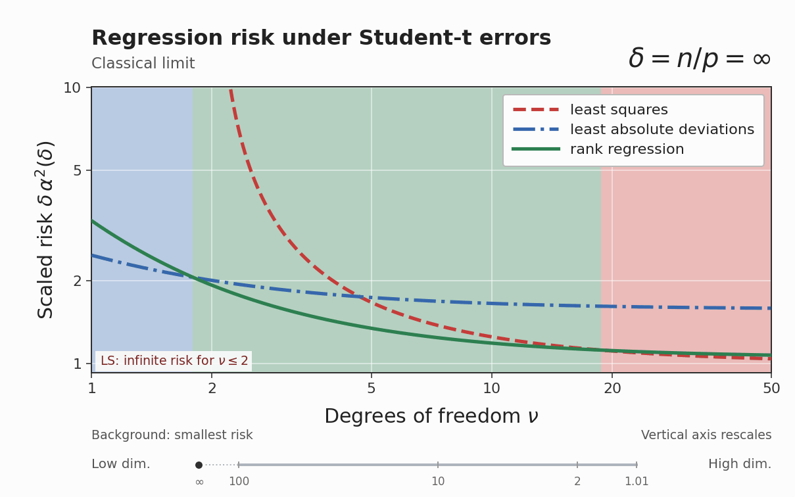

# High-dimensional rank regression

Code and data for **High-Dimensional Rank Regression: Exact Risk and Effective-Score Phase Transition**, by K. Sawaya, Y. Uematsu, and M. Imaizumi.

This repository compares least squares (LS), least absolute deviations (LAD), and rank regression under Gaussian designs. It provides scalar risk solvers, finite-sample simulations, and scripts for the paper's figures.



The animation plots **δ α²(δ)** against the Student-t degrees of freedom, where n/p → δ in the proportional limit. It starts at the classical limiting constants (δ = ∞), then decreases δ from 100 to 1.01. The vertical axis rescales between frames; LS is omitted where its risk is infinite. [Animation details and generation code](docs/animation.md).

## Installation

Use Python 3.10–3.12 and run these commands from the repository root:

```bash
python3 -m venv .venv
source .venv/bin/activate
python3 -m pip install -r requirements-tested.txt
python3 -m pip install -e '.[animation]'
```

On Windows, activate with `.venv\Scripts\activate`. For the notebook, also install `python3 -m pip install -e '.[notebook]'`.

## Reproduce the figures

```bash
rank-repro audit --strict
rank-repro figures --group all --output-dir build/figures
python3 animation/render_gifs.py --output-dir build/animation
```

The static figure command reads the tables in `data/paper/` and computes the remaining scalar curves. It writes PDF and PNG files without running finite-sample simulations. [Figure inputs and interpretation](docs/figure-map.md) · [Numerical methods and checks](docs/reproduction.md) · [Interactive notebook](notebooks/vis.ipynb).

To regenerate only Figures 8–10:

```bash
rank-repro figures --group heavy --figures 8 9 10 --output-dir build/figures
```

## Numerical conventions

- The asymptotic aspect ratio is defined by n/p → δ. Student-t errors have scale one, without variance standardization. Unpenalized LS risk is infinite for degrees of freedom at most two.
- ARE(A:B) = risk(B) / risk(A); values above one favor A.
- The penalized objective is `loss_average + (lambda/n) * sum(g(beta_j))`, with `g(b) = b²/2` for ridge and `g(b) = |b|` for lasso.
- Penalized simulations use iid `0.8 delta_0 + 0.2 N(0,5)` coefficients.
- Figure 10 selects each penalty by median Monte Carlo MSE, then displays mean MSE at that penalty using the same repetitions. This is oracle tuning, not cross-validation.

## Run the experiments

```bash
# Inspect the configured workload.
python3 tools/run_recompute_plan.py --output-dir results --dry-run

# Compute locally, with one BLAS thread per worker.
python3 tools/run_recompute_plan.py --workers 8 --output-dir results
```

The configured plan combines new calculations with saved inputs; its scope and the standalone experiment configurations are described in [the reproduction guide](docs/reproduction.md). Successful checkpoints are reused when the source and configuration match.

An optional launcher runs the plan on an existing Google Cloud VM:

```bash
bash run_gcp.sh --project YOUR_PROJECT_ID --workers 100
```

It stops the selected VM only after successful computation and verified result retrieval. Errors leave the VM running. [Cloud execution and reconnecting](docs/reproduction.md#cloud-execution).

The production computation took approximately 27.5 hours on a Google Cloud `n2d-highcpu-128` VM. Runtime depends on CPU, memory, and worker count.

## Repository contents

| Location | Contents |
|---|---|
| `src/rank_repro/` | Risk equations, optimization, simulations, plotting |
| `data/paper/` | Figure tables and numerical metadata |
| `data/recovered/`, root `data/*.csv` | Saved inputs used by the computation plan |
| `figures/` | PDF/PNG figures and scalar-curve diagnostics |
| `animation/`, `assets/animations/` | Animation grid, generator, and GIF |
| `configs/` | Experiment and smoke-test configurations |
| `provenance/` | Source snapshots and data/checkpoint hashes |
| `tools/` | Execution, data import/export, and verification |
| `tests/` | Numerical and workflow tests |

[Raw numerical records for v0.3.0](https://github.com/sawaya-ka/rank-regression/releases/download/v0.3.0/rank-results-v0.3.0.tar.gz) are available as a release asset (approximately 546 MB). See [`CITATION.cff`](CITATION.cff) for citation information.

```bash
python3 -m unittest discover -s tests -v
```
