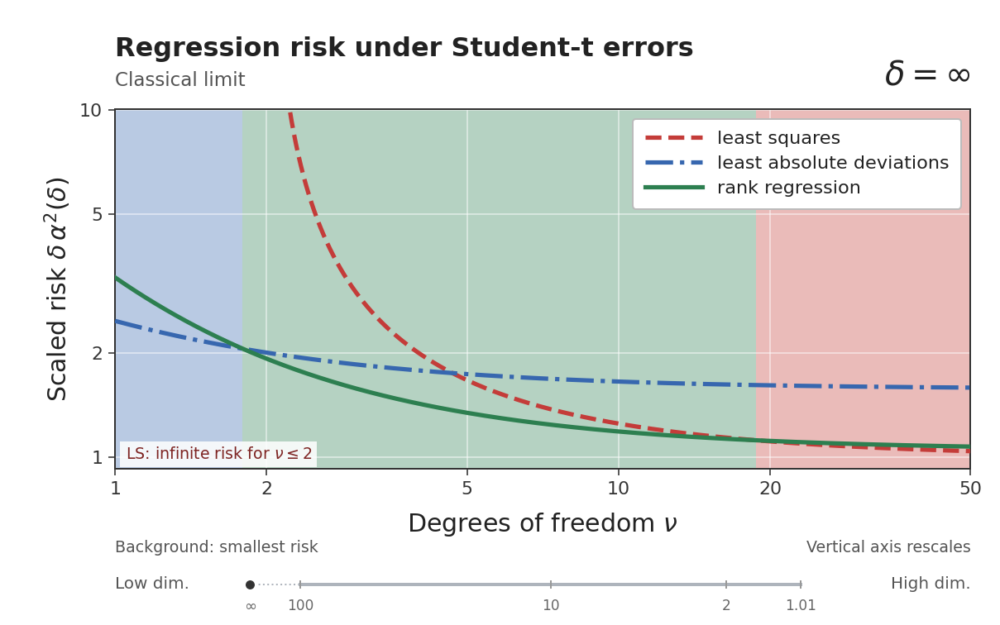

# Student-t risk animation

The README animation extends the comparison in Figure 1(a) from the classical limit to increasing dimensionality.
It uses location-zero, scale-one Student-t errors, without variance standardization.
The horizontal axis is the degrees of freedom, ν. The asymptotic aspect ratio δ, defined by n/p → δ, decreases as the animation proceeds.



## What is plotted

The vertical axis of `fig1a_scaled_risk.gif` is **δ α²(δ)**.
The initial frame, labelled δ = ∞, displays the limiting constants lim δ α²(δ), not the unscaled risks.
The finite frames use 100 values from 100 to 1.01, logarithmically spaced and rounded to three significant digits **before solving**.
The ν grid has 104 points: 100 logarithmic points from 1 to 50, augmented with ν = 2, ν = 3, and the classical winner crossings.

LS has infinite risk for ν ≤ 2 and is omitted there rather than plotted as zero.
The background identifies the lowest of the three displayed risk curves.
The vertical axis rescales between frames; compare axis values, not just curve heights.
Winner boundaries close to ties depend on numerical accuracy and display interpolation.

Every finite δ has its own computed risks.
PCHIP interpolation of log risk in log ν is used only to draw smooth LAD and Rank curves.
LS is drawn directly from its formula ν / ((ν − 2)(δ − 1)) for ν > 2.
The initial classical frame uses the shared solver's closed-form constants.
The animation grid is separate from the manuscript phase-grid computation and is not a visualization of empirical Monte Carlo repetitions.

## Render from the committed grid

After installing the repository package, install Pillow if needed:

```bash
python3 -m pip install 'Pillow>=10,<13'
python3 animation/render_gifs.py --output-dir build/animation
```

This uses `animation/data/risk_grid.npz` and does not rerun the risk solver.
It writes the scaled GIF, four preview images, a contact sheet, and rendering metadata to `build/animation`.
The committed GIF has 101 frames, a 1209 × 756 canvas, a 16.08-second loop, and a size of approximately 4.8 MB.
The first and last frames pause for 1.8 and 2.4 seconds respectively; other frames last 120 ms.
Use `--frame-ms 180` to slow the intermediate frames.
GIF frame times must be multiples of 10 ms.

To generate an unscaled version:

```bash
python3 animation/render_gifs.py --mode raw --output-dir build/animation
```

That version plots α²(δ).
Its initial frame uses a linear vertical axis because the finite-risk classical limits are zero; subsequent frames use a logarithmic vertical axis.
Use `--mode both` to generate both versions.

## Recompute the grid

```bash
python3 animation/compute_risks.py --workers 6 --order 600
python3 animation/render_gifs.py --data build/animation-data/risk_grid.npz --output-dir build/animation-recomputed
```

The computation writes to `build/animation-data` and leaves the committed grid unchanged.
Both scripts use `rank_repro.student`; there is no separate copy of the numerical solver.
The original grid calculation and selected higher-order checks took approximately 330 seconds with six workers in its recorded environment; runtime depends on hardware and numerical-library versions.

LAD and Rank use 600-node quadrature.
The supplied `numerical_validation.json` records comparisons with 1200 nodes at 28 selected (ν, δ) points.
The largest recorded relative difference is 9.56 × 10⁻⁵, below the diagnostic tolerance of 5 × 10⁻⁴.
These comparisons are numerical diagnostics, not rigorous or uniform error bounds over the whole animation grid.
Near-equal risks should not be interpreted as substantial advantages.

## Files

Rendering bytes can vary with fonts and library versions.

| File | Content |
|---|---|
| `assets/animations/fig1a_scaled_risk.gif` | Animated figure displayed in the README |
| `assets/animations/fig1a_classical.png` | Static initial frame |
| `animation/data/risk_grid.npz` | Finite risks, classical constants, cutoffs, and grid coordinates |
| `animation/data/risk_grid.csv` | Finite-grid values in a readable table |
| `animation/data/numerical_validation.json` | Quadrature comparisons |
| `animation/data/environment.json` | Python and package versions used for the grid |
| `animation/compute_risks.py` | Risk-grid computation with selected higher-order checks |
| `animation/render_gifs.py` | Renderer using committed or newly computed data |
